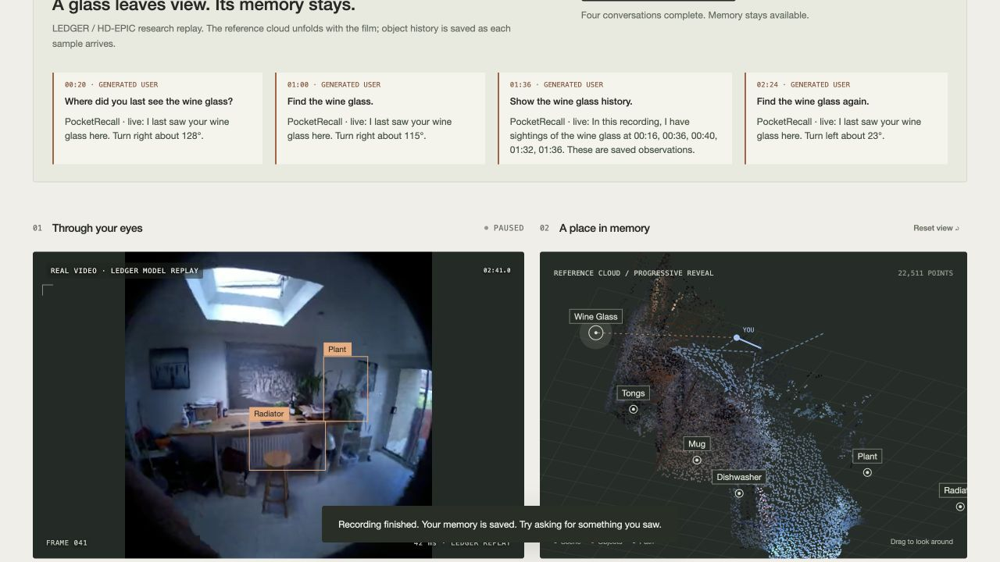

# PocketRecall

**A little less lost.** A no-app spatial memory service: your glasses notice objects, memory keeps their last-seen places, and you ask out loud when you need them. The intended experience uses voice, sound and touch. This working webpage simulates the glasses and shows the evidence behind each answer.

▶ **[Concept film (1:46)](https://drive.google.com/file/d/1XA-NO-P9L9DJUAbpsXPJBeitypxOCQzd/view)** ([mp4 in repo](media/pocketrecall-concept-film.mp4)) — the product vision. Its HUD, 3D map and footage are simulated with CC0 photos ([credits](media/CREDITS.md)); the working demo is below.

## Judges: start here

Requires **Node.js 22+**. The bundled demo runs **without an API key, glasses or a reconstruction server**.

```sh
git clone https://github.com/CHYYYYYYYY/pocketrecall.git
cd pocketrecall
npm ci
npm start
```

Open **http://localhost:3000/run** and click **Watch kitchen + conversation**. Allow about 2–3 minutes. You will see a real kitchen video, a growing reference map, saved object locations and four spoken questions. No microphone permission is needed for this guided playback.

For actual **Gemini Live** answers, create `.env.local` from [.env.example](.env.example) if it does not already exist, set `GEMINI_API_KEY`, then restart `npm start`. Without a key, replies use the same memory tools and browser speech, visibly labeled. `FAL_KEY` is optional and is **not needed** for either bundled sample.

## Try it

1. Click **Watch kitchen + conversation**. The bundled real LEDGER / HD-EPIC kitchen video plays at 2× while the reference point cloud unfolds, object histories accumulate, and a generated user asks four questions about a wine glass. No microphone is needed for this guided demo.
2. With `GEMINI_API_KEY` in `.env.local`, those questions stream as real audio alongside video frames to **Gemini Live**. Answers call the actual memory tools and return spoken audio. Without a key, the demo uses explicitly labeled memory tools + browser speech. Geometry and detections are credited research replays, not a new reconstruction run.
3. To talk yourself, tap the microphone or **Try it with your eyes up**. Open **Why this answer** or an object card to inspect evidence. **Real desk** offers a second real sample with measured depth, reference camera poses, and an option to **Recognize again with Gemini**.
4. **Your memory** reopens saved sessions. **Demo** is the separate synthetic keys/wallet scenario: use arrows / WASD to move the virtual wearer, Q / E to tilt, or say **“I'm heading out”** and **“Got it”**. Sound gives a proximity heartbeat; desktop taps are visualized.

Keys stay on the server. Live sends microphone audio (generated speech in the guided demo) and video at 1 fps to Gemini; stopping it or hiding the page releases capture. Memories remain in ignored `.pocketrecall-data/`. Kitchen footage is for non-commercial research demonstration; [credits and transformations](public/assets/ledger/ATTRIBUTION.md).



## Your video and hardware

**Use your video** recognizes registered objects with Gemini. Automatic RGB-only reconstruction optionally needs `FAL_KEY`; overlapping VGGT windows are aligned into one relative-scale map. Without geometry, evidence is saved but no 3D directions are invented. RGB-D/SLAM and current-pose adapters are documented; physical glasses, general relocalization and arbitrary-room mapping are not deployed.

## Who it is for, and what comes next

We are designing for **everyday people who misplace belongings**, **older adults who want a simple spoken way to keep track of familiar items**, and **warehouse workers who regularly need to recall tools and supplies**. The promise is less searching, with an image and a time behind each remembered location. These are target use cases, not validated user-study outcomes.

For **physical intelligence**, we see the same object–place–time memory becoming an interface between human observations and robot perception, spatial reasoning and assistance. Shared maps, reliable relocalization and physical execution are future integration and evaluation work. The current prototype demonstrates the memory and conversation loop.

## Verify

```sh
npm test
npm run check
npm run smoke          # Real HTTP + new-process persistence check
npm run judge          # Real footage + recorded predictions; no key required
npm run judge:live     # Real Gemini vision + Live audio/video; consumes API quota
npm run judge:kitchen  # 41 real kitchen samples, temporal memory and restart
npm run judge:kitchen:live # Four generated speech turns through real Gemini Live
npm run preview:build  # Standalone synthetic preview
```

[Judge walkthrough & architecture](docs/HACKATHON.md) · [Validation](docs/VALIDATION.md) · [Related research](docs/RELATED_WORK.md) · [API / storage](docs/RUN_DEMO.md)
