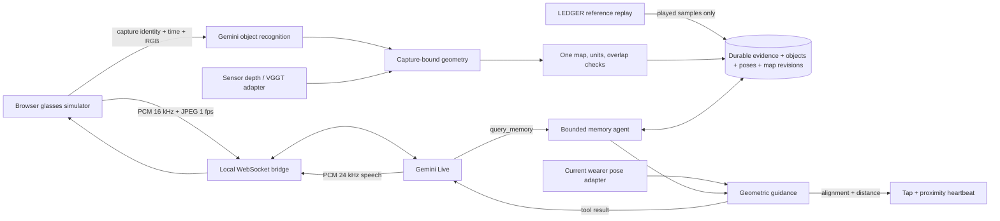

# A runnable memory loop

PocketRecall connects a glasses-like video view to persistent spatial evidence and a duplex voice agent. It is a hackathon prototype, not a benchmark-leading visual grounding model or a deployed navigation device.

## A two-minute judge walkthrough

The fastest entry is **Watch kitchen + conversation** on `/run`. It plays the bundled 2:41 LEDGER / HD-EPIC video at 2×, pauses at four scripted questions, then resumes after each spoken answer. With the Gemini key configured, generated PCM speech and the current video are sent through the actual Gemini Live bridge, which calls the memory agent. No physical microphone is requested. Without a key, a visibly labeled mode calls the same tools using the scripted text and browser speech.

| Video time | Generated user's question | Expected evidence |
| --- | --- | --- |
| 00:20 | Where did you last see the wine glass? | Most recent saved sighting: 00:16 |
| 01:00 | Find the wine glass. | 00:40 remains retrievable through the detection gap |
| 01:36 | Show the wine glass history. | Only 00:16, 00:36, 00:40, 01:32, 01:36; no future sightings |
| 02:24 | Find the wine glass again. | Reacquired observation at 02:24 |

The video is real; object identities/locations are **replayed LEDGER model outputs**. The Pi3X + TSDF reference cloud is revealed using an approximate camera frustum and coarse depth buffer. This shows the memory forming on the webpage, not online reconstruction. The export supplies camera centers/forward vectors; roll is approximated as zero and units are conservatively relative. The simulated wearer follows the recorded camera at each sample. This is not measured physical guidance or a real lost-object retrieval experiment. [Full data credits and preparation](../public/assets/ledger/ATTRIBUTION.md).

`npm run judge:kitchen` verifies the 41 samples, temporal cutoffs, one map, evidence and restart. `npm run judge:kitchen:live` additionally sends all four generated questions and concurrent current-frame JPEGs to the real provider. Reports/audio go to ignored `.pocketrecall-data/verification/`.

## Real recognition and calibrated geometry

1. Start the Node server, open `/run`, select **Real desk → Replay recorded model results**, and play the 20-second clip. No key is needed. The scene is real TUM RGB-D camera footage; the recognizer outputs were actually produced by Gemini. Both their model name and execution provenance are bundled.
2. Watch Keyboard, Mouse and Mug acquire image evidence and positions in `tum-fr1-desk`. Observations only enter memory when their sample is played. A missing or uncertain detection never deletes the last seen location. Point geometry and map revisions persist separately from the page.
3. With `GEMINI_API_KEY` configured, tap the microphone. Ask **“Where did you last see the keyboard?”** while the video plays. Gemini Live receives ongoing audio and sampled video, calls `query_memory`, and reads the grounded direction. Open **Why this answer** to inspect the tools and saved image. Speak again to interrupt.
4. Use arrow keys to turn/approach in the **simulated wearer** controls. Alignment triggers a visual tap (device vibration if supported); proximity increases the heartbeat. Say **“Got it”** to report possession. Mere proximity cannot confirm it.
5. Reload or restart the server, then reopen the session in **Your memory**. Saved images, object history and map versions remain. Use **Recognize again with Gemini** to repeat the eight real vision API calls rather than replaying stored predictions.

For an unattended integration rehearsal, `npm run judge` checks real-footage replay; `npm run judge:live` adds actual recognition and streams a generated English audio question plus JPEG frames through the same Live server bridge. Results and returned WAV audio are written under ignored `.pocketrecall-data/verification/`. It does not activate the user's microphone.

## Agent and memory architecture

The visual observer and live conversation share one `RunSession`. Live sees the current sampled view but cannot silently write coordinates or claim that a visible object was saved. It must call memory tools for recalled facts. The observer saves detections, frame hashes and capture metadata independently of conversation.

`MemoryAgent` routes direct commands immediately, or uses a constrained Gemini plan for less direct wording. It allows search, history, find, departure, confirmation, next, pause/resume, cancel and status. Only tools produce remembered coordinates and directions. Each turn retains its tool trace and evidence references; a model cannot fabricate a possession report. Session changes abort old work. Live tool confirmations additionally require a recent explicit input transcript.

Durable memory stores registered entities, immutable sightings, image hashes, capture poses, map versions and explicit user reports. Unclear detections add no negative evidence; a later absence leaves earlier sightings retrievable. Live's dialogue context is transient; raw microphone streams are not written to disk. Up to 30 agent tool turns are retained per session.

## One map and a current location

Each capture binds the exact RGB bytes, pose, intrinsics and depth. Object positions come from the median depth around a detected box center, unprojected through the capture pose. This is a coarse object anchor, not a segmentation centroid or a learned 3D box.

The real desk demo uses measured registered Kinect depth and reference motion-capture poses. It demonstrates the memory/agent pipeline without a hosted reconstruction model. Source timestamps and depth/pose offsets are preserved in observation semantics; `capturedAt` is the session replay timeline. Original captures are within 25 ms of their associated measurements. Map units are meters and the first camera defines one fixed coordinate frame.

RGB-only VGGT runs start with at least three keyframes. Later windows include three previously mapped captures and up to five fresh frames. Camera orientations and baselines estimate one similarity transform; orientation disagreement above 5 degrees, insufficient translation, or residual above 8% of the shared baseline reject the extension. Valid depths, poses and new points are transformed into the existing map. Earlier object history stays unchanged. This is conservative overlap alignment within one recording, not general cross-session map merging or loop closure.

The query never teleports the wearer to a capture pose. Simulation is labeled. A hardware current-pose update must use the active map, matching units and a timestamp less than three seconds old. Stale/lost poses suppress directional, tap and heartbeat guidance. Restarting cannot revive a physical tracking lock.

## Adapter contracts

Session-bound HTTP mutations use JSON and a current `sessionId`; source-start routes create a fresh session. The local server binds to loopback and rejects foreign Host/Origin headers. This is a local demo, not a public multi-user deployment.

| Input | Endpoint / fields | Contract |
| --- | --- | --- |
| RGB frame | `POST /api/run/frame`: `sessionId, seq, videoTime, imageDataUrl` | 518-square letterboxed image; monotonic capture sequence; response returns `frameId, capturedAt, imageSha256` |
| RGB-D / SLAM geometry | `POST /api/run/geometry`: `sessionId, frameId, imageSha256, coordinateUnits, provenance, pose, intrinsics, depth` | Exact capture hash/time; row-major `worldFromCamera`; intrinsics for that 518-square image; registered optical-Z depth raster, zero = missing; explicit meters/relative units |
| Wearer localization | `POST /api/run/pose`: `sessionId, coordinateUnits, pose` | `pose` includes `mapId, capturedAt, trackingState, worldFromCamera`; pose in the current map, clock synchronized and fresh. Response returns updated guidance for the adapter to actuate |
| Agent | `POST /api/run/agent`: `sessionId, text` | Bounded planning, durable tools, evidence and state |
| Duplex conversation | `WS /api/run/live?sessionId=…` | Same-origin browser; microphone `audio` events contain base64 PCM16LE mono 16 kHz; `video` contains JPEG base64 at 1 fps; `text` is optional typed input |
| Live outputs | `ready, audio, transcript, agent, interrupted, turnComplete, notice, error` | Output audio PCM 24 kHz; interruption stops all scheduled playback; session change closes the stream |

Provider credentials never enter browser code. Live closes on session switch, tab hiding or explicit stop. Audio capture uses an AudioWorklet with continuous resampling, echo cancellation and bounded WebSocket queues. Generated demo speech uses explicit activity boundaries and a silence tail; a failed turn reconnects and retries once with a visible status. Natural microphone input uses automatic voice detection. Browser speech recognition/TTS remains a labeled fallback. The standalone preview has no cloud connection.

## Remaining integration work

- **No FAL key:** automatic RGB-only reconstruction is implemented behind an adapter and covered with provider mocks; live fal execution is unverified. The kitchen uses a precomputed reference; the desk uses sensor geometry.
- **No physical glasses:** camera transport, device pose estimation/relocalization, clock calibration, metric scale and actual haptic hardware need device validation. Interfaces isolate these tasks; they do not make tracking and deployment trivial.
- **Recognition scope:** up to 12 registered categories, one tracked item per category. General instance re-identification, segmentation, long-duration loop closure, arbitrary-room deployment and obstacle-aware routing are not implemented.
- **Validation scope:** real provider audio/video and real image recognition have passed. Physical microphone/speaker, acoustic echo and human barge-in still need rehearsal on the presentation laptop. Guidance points toward a last-seen anchor, not a collision-free walking route.

See [validation evidence](VALIDATION.md) and [research comparison](RELATED_WORK.md).
